# BDF Lab 3 - REST API, Query Parameters, Validation & Debugging

**Student Name:** Y. Eswar sai durga prasad  
**Registration Number:** 252U1R3104  
**Class:** CSE-DS-2B  
**Live Deployed URL:** https://backend-lab03.onrender.com/  
**GitHub Repository:** https://github.com/eswarsaidurgaprasad-hash/backend-lab03  

A complete Node.js + Express + SQLite implementation of Lab 3, continued from the Lab 2 `book` table approach.

## Requirements covered

- Resource-based noun endpoint: `/books`; HTTP methods represent actions.
- `GET /books` supports `search_q`, `order_by`, `order`, `limit`, and `offset`.
- Defaults: `search_q=""`, `order_by=id`, `order=ASC`, `limit=10`, `offset=0`.
- Partial title search uses SQL `LIKE`.
- Price range supports `min_price` and `max_price` (inclusive conditions equivalent to `BETWEEN`).
- POST and PUT validate title, author and numeric price.
- Status codes: 201 create; 200 read/update/delete; 400 invalid input; 404 missing book.
- Consistent JSON error format: `{ "message": "..." }`.
- SQL values use parameterized queries. Sort column and direction are validated against allowlists.
- Database initialization and database reads/writes are awaited.
- The `data` directory is created automatically at startup to prevent SQLite `SQLITE_CANTOPEN` errors.

## Setup (Windows CMD / VS Code terminal)

1. Extract the ZIP.
2. Open the extracted `lab-03-rest-api` folder in VS Code.
3. Install dependencies:
   ```bash
   npm install
   ```
4. Start the server:
   ```bash
   npm start
   ```
   For development with auto-restart:
   ```bash
   npm run dev
   ```
5. Open `http://localhost:3000/` (or live at `https://backend-lab03.onrender.com/`). The SQLite database `data/books.db` is created automatically and seeded with 10 sample books on the first run.

If port 3000 is busy, run:
```cmd
set PORT=3001 && npm start
```
Then use `http://localhost:3001`.

## API endpoints

| Method | Endpoint | Purpose |
|---|---|---|
| GET | `/books` | List, search, sort, filter and paginate |
| GET | `/books/:id` | Get one book |
| POST | `/books` | Create a book |
| PUT | `/books/:id` | Update a book |
| DELETE | `/books/:id` | Delete a book |

### GET query parameters

| Parameter | Default | Example |
|---|---|---|
| `search_q` | empty | `?search_q=code` |
| `order_by` | `id` | `?order_by=price` |
| `order` | `ASC` | `?order=DESC` |
| `limit` | `10` | `?limit=5` |
| `offset` | `0` | `?offset=5` |
| `min_price` | none | `?min_price=200` |
| `max_price` | none | `?max_price=500` |

Combined example:
`GET http://localhost:3000/books?search_q=the&order_by=price&order=DESC&min_price=200&max_price=600&limit=5&offset=0`

Allowed `order_by`: `id`, `title`, `author`, `price`. Allowed `order`: `ASC`, `DESC`. `limit` must be 1–100; `offset` must be a non-negative integer.

## Postman testing

Import `postman/Lab-03-Books-API.postman_collection.json` into Postman. Set `baseUrl` to `http://localhost:3000` if needed. Run requests in the collection. The collection includes successful and failure cases for list/search/filter, CRUD, validation, invalid sort/pagination, and missing IDs.

### Sample request body
```json
{
  "title": "Learning Node.js",
  "author": "Y. Eswar sai durga prasad",
  "price": 399
}
```

### Example responses

Successful create (201):
```json
{
  "message": "Book created successfully",
  "data": {
    "id": 11,
    "title": "Learning Node.js",
    "author": "Y. Eswar sai durga prasad",
    "price": 399
  }
}
```

Validation failure (400):
```json
{ "message": "title is required and must be a non-empty string" }
```

Missing record (404):
```json
{ "message": "Book not found" }
```
## Screenshots

1.	Name the endpoints as nouns (/books) and use the HTTP method to show the action.
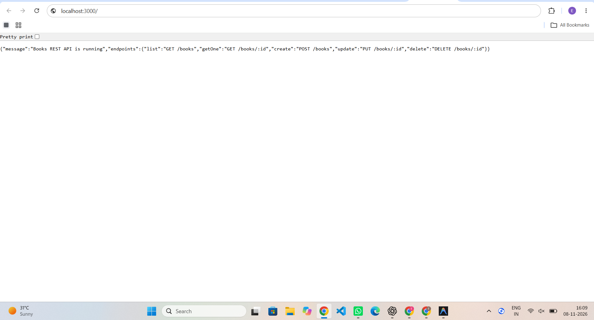
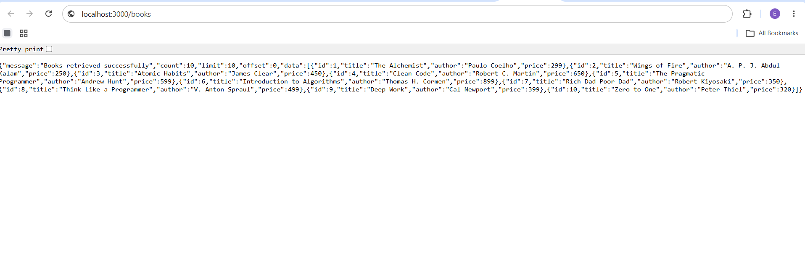
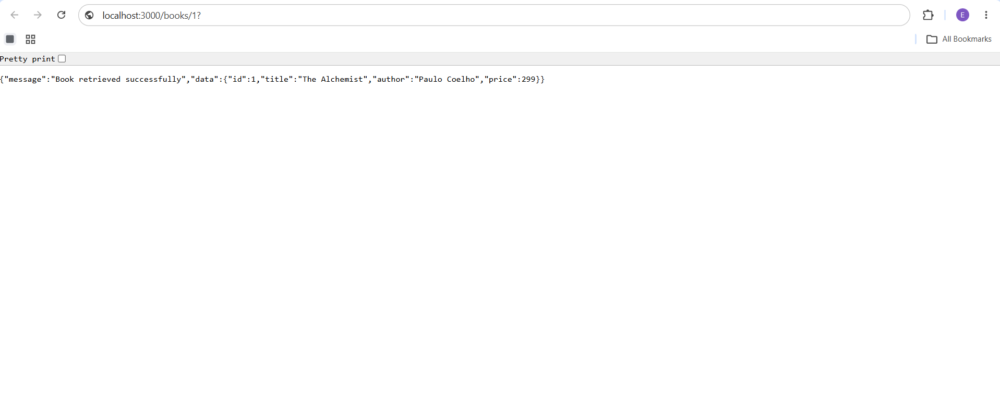

2.	Add query parameters to GET /books/: search_q (partial title match with LIKE), order_by, order (ASC/DESC), limit and offset, each with a default value.
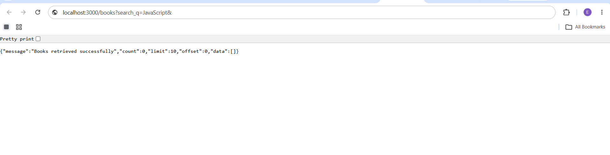
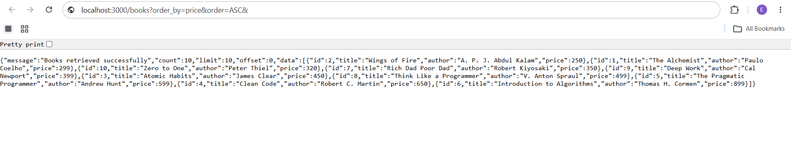
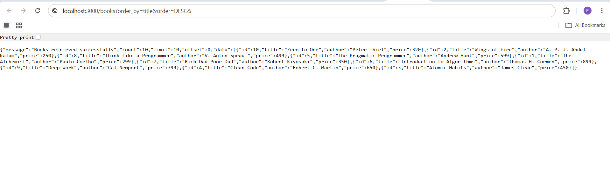

3.	Add a price-range filter, for example min_price and max_price using BETWEEN or two conditions.
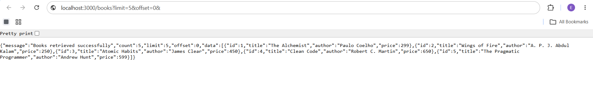
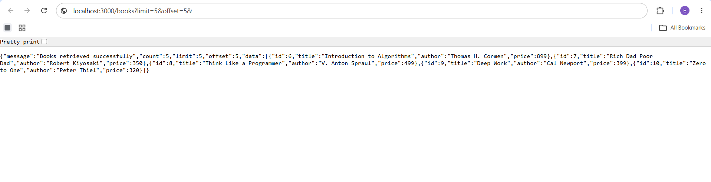

4.	Validate the POST body: reject missing title, author or a non-numeric price with 400 and a clear JSON message.
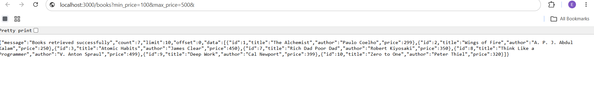
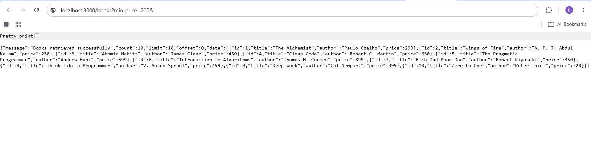
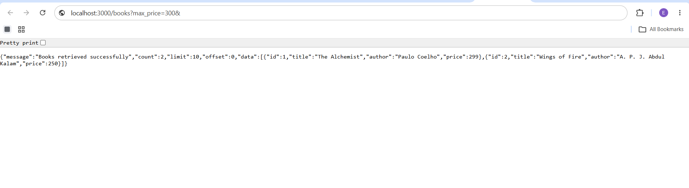

5.	Return 201 after create, 200 after update and delete, and 404 when the id does not exist.
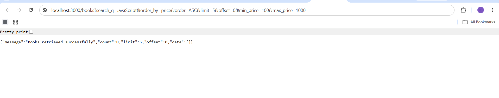

6.	Make the response format consistent, for example { "message": "..." } for errors.
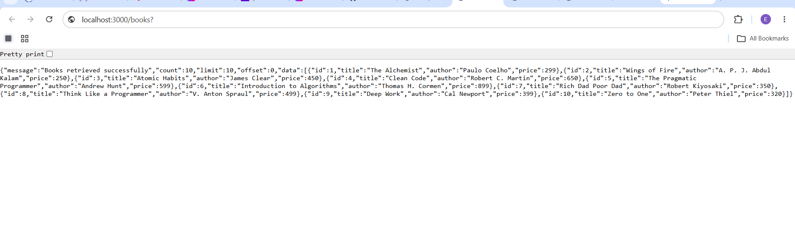

7.	Debugging exercise: the faculty hands out a broken version of the project. Students fix a port conflict (EADDRINUSE), a wrong import path, a table-name typo (no such table) and a missing await.

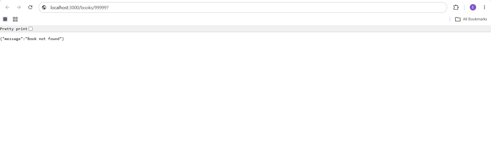
## Debugging exercise - issue and resolution

1. **EADDRINUSE (port already in use):** Another process is using the selected port. Stop the old Node process (Ctrl+C in its terminal) or start with another port using `set PORT=3001 && npm start`.
2. **Wrong import path:** Check the relative path and filename. The route imports `../database` from `src/routes/books.js`, which correctly resolves to `src/database.js`.
3. **No such table:** Ensure the table name is exactly `book` (singular) in both table creation and SQL queries. The database setup runs before the server starts.
4. **Missing await:** Await asynchronous database operations such as `db.get`, `db.all`, `db.run`, and `openDatabase()` before using their results.

## Viva preparation

- **Query parameter vs path parameter:** Query parameters follow `?` and are commonly used for filtering/sorting/pagination (for example, `/books?limit=5`). A path parameter is part of the URL path and identifies a resource (for example, `/books/3`).
- **Stateless:** Each HTTP request contains the information needed to process it; the server does not depend on stored client session state from a previous request.
- **Bad input vs missing record:** `400 Bad Request` for invalid input; `404 Not Found` when the requested resource does not exist.

## Submission notes

- Do not commit `.env` or `node_modules`.
- `node_modules` is intentionally excluded from this ZIP; run `npm install`.
- `data/books.db` is generated automatically at first launch.
- Capture your own Postman screenshots after running the API if your faculty requires visual testing evidence.
